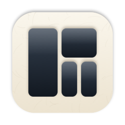

<p align="center"></p>

# Mosaïque

Rangement automatique des fenêtres pour macOS. Ouvre une fenêtre, Mosaïque lui donne une place : pas de glisser, pas de redimensionnement, pas de disposition à configurer.

- **Grille ou colonnes**, de 1 à 4 fenêtres par écran (des lignes sur un écran vertical). Chaque écran et chaque Space garde son choix.
- **Piles** : quand l'écran est plein, la nouvelle fenêtre rejoint la case où tu travailles. Une poignée orange au-dessus de la fenêtre montre la pile ; en la survolant, une barre affiche les onglets (glisse-les pour les réordonner, ou sur une autre case pour y déplacer la fenêtre).
- **Focus**, **No peek** (les autres fenêtres s'effacent), **Clean Space** (fond uni pour partager l'écran) et **Tab View** (toutes les fenêtres, écran par écran).
- **Souris ou clavier** : ⌘-glisser pour échanger, ⌥⌘-glisser pour empiler, tirer un bord pour redimensionner, raccourcis ⌃⌥.
- Animations fluides, plusieurs écrans, tailles minimales apprises, apps exclues, réglages complets. Fonctionne hors ligne, ne lit jamais le contenu des fenêtres, n'envoie rien.

## Installation

Il faut **macOS 15 Sequoia** ou plus récent (Apple Silicon ou Intel).

**En une commande** — colle ceci dans Terminal :

```sh
curl -fsSL https://raw.githubusercontent.com/yaibnmo/mosaique/main/install.sh | bash
```

Le script télécharge la dernière version, l'installe dans Applications et l'ouvre. La même commande sert aussi à mettre à jour.

**À la main** — télécharge `Mosaique.zip` dans les [Releases](https://github.com/yaibnmo/mosaique/releases/latest), décompresse-le et place `Mosaique.app` dans Applications. L'app n'est pas notarisée par Apple : au premier lancement, macOS la bloque. Lance alors dans Terminal :

```sh
xattr -dr com.apple.quarantine /Applications/Mosaique.app
```

ou va dans Réglages Système › Confidentialité et sécurité et clique sur « Ouvrir quand même ».

### Premier lancement

1. Une visite de bienvenue s'ouvre. Rien ne bouge avant la fin.
2. Autorise Mosaïque dans **Réglages Système › Confidentialité et sécurité › Accessibilité** : macOS l'exige pour qu'une app puisse déplacer les fenêtres des autres.
3. Choisis ta disposition, puis clique sur **Ranger mon espace**.

Mosaïque vit dans la barre des menus (pas d'icône dans le Dock). Si son icône n'apparaît pas, ta barre des menus est peut-être pleine : vérifie Réglages Système › Barre des menus, ou rouvre Mosaïque depuis Applications pour afficher ses réglages.

> **Après une mise à jour**, macOS considère la nouvelle copie comme une autre app : réactive-la dans Accessibilité. Si la case est cochée mais que Mosaïque attend toujours, retire la ligne avec « − » et relance l'app (le script d'installation s'en charge).

## Raccourcis

| Raccourci | Action |
|---|---|
| ⌃⌥⌘ 1 à 4 | Nombre de fenêtres sur l'écran actif |
| ⌃⌥ ← → ↑ ↓ | Échanger avec la fenêtre voisine (ou passer à l'écran suivant) |
| ⌃⌥ ↩ | Mettre la fenêtre active en grande place |
| ⌃⌥ ` / ⌃⌥⇧ ` | Fenêtre suivante / précédente de la pile |
| ⌃⌥ ] / ⌃⌥ [ | Fenêtre suivante / précédente |
| ⌥ ⇥ | Tab View |
| ⌃⌥ = / ⌃⌥ - / ⌃⌥ 0 | Agrandir / réduire / tailles égales |
| ⌃⌥ F / ⌃⌥⇧ F | Faire flotter / toujours faire flotter ce type de fenêtre |
| ⌃⌥ Z | Focus |
| ⌃⌥ D | No peek |
| ⌃⌥ P | Clean Space |

Les raccourcis suivent les lettres de ton clavier (AZERTY compris).

## Compiler soi-même

Il faut les outils de développement d'Apple (`xcode-select --install`).

```sh
git clone https://github.com/yaibnmo/mosaique.git
cd mosaique
zsh build.sh                 # → dist/Mosaique.app (universelle) et dist/Mosaique.zip
cp -R dist/Mosaique.app /Applications/
```

Avec la signature par défaut (ad hoc), macOS redemande l'autorisation Accessibilité à chaque recompilation. Pour l'éviter, signe avec ton certificat : `MOSAIQUE_SIGN="Apple Development: toi@exemple.com (XXXXXXXXXX)" zsh build.sh` (liste tes certificats avec `security find-identity -v -p codesigning`).

Le code est en Swift (AppKit + SwiftUI), sans dépendance. `Sources/WindowEngine.swift` contient le moteur, `Sources/Layout.swift` la géométrie et les piles (testées par `Tests/LayoutTests.swift`).

## Désinstaller

Quitte Mosaïque depuis son menu, supprime `/Applications/Mosaique.app`, puis, si tu veux tout effacer :

```sh
defaults delete io.github.yaibnmo.mosaique
rm -rf ~/Library/Application\ Support/Mosaique
tccutil reset Accessibility io.github.yaibnmo.mosaique
```

## Licence

MIT. Projet indépendant inspiré des gestionnaires de fenêtres par pavage ; il n'est affilié à aucun autre logiciel ni à aucune marque.
